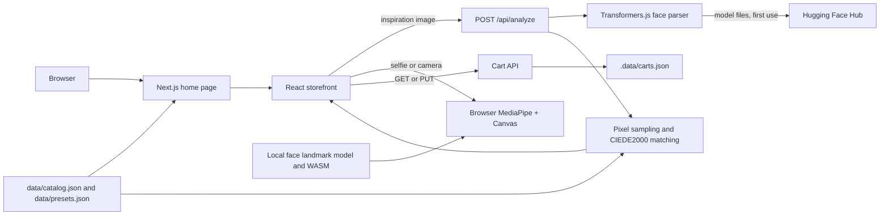

# Architecture

The project is a single Next.js 16 App Router application. React renders the storefront; four API routes handle catalog reads, image analysis, and the demo bag. There is no separate Python service or database.

## Runtime boundaries

- **Server-rendered entry:** `src/app/page.tsx` imports the catalog and presets, then renders `Storefront`. `src/app/layout.tsx` supplies metadata and CSS.
- **Browser UI:** `src/components/Storefront.tsx` manages search, category filter, wizard steps, selected matches, snapshots, and bag state. `OriginalStorefrontTop.tsx` renders the header, hero, and feature banner.
- **Server analysis:** `src/app/api/analyze/route.ts` validates the upload and calls `src/lib/analysis.ts`. This runs in the Node.js runtime. `next.config.ts` keeps Transformers.js external to Next's server bundle.
- **Browser try-on:** `src/components/TryOn.tsx` loads MediaPipe, tracks one face, handles camera or selfie input, and calls `src/lib/tryon-renderer.ts` to paint the canvas.
- **Catalog and matching:** `src/lib/catalog.ts` maps the JSON records to app types. `src/lib/matching.ts` compares measured colors with catalog swatches using functions in `src/lib/color.ts`.
- **Demo bag:** `src/app/api/cart/route.ts` manages the session cookie. `src/lib/cart.ts` validates lines and writes `.data/carts.json`.

## Files and ownership

| Path | Role |
| --- | --- |
| `data/catalog.json` | Twelve sample products and their shade data |
| `data/presets.json` | Three sample inspiration looks |
| `public/assets/images/` | Images served directly to the browser |
| `public/models/`, `public/mediapipe/wasm/` | Local browser try-on runtime assets |
| `src/lib/types.ts` | Shared shapes for zones, products, analysis, matches, and cart lines |
| `src/app/globals.css`, `original-home.css`, `tryon.css` | Storefront and try-on styles |
| `legacy/` | Original static prototype, excluded from the TypeScript build |
| `tests/color.test.mjs` | Color conversion and CIEDE2000 checks |

The inspiration image and try-on selfie serve different purposes. Analysis derives colors from the inspiration image on the server; the separate selfie or camera is used for the browser preview. See [Image analysis](image-analysis.md) and [Virtual try-on](virtual-try-on.md).
